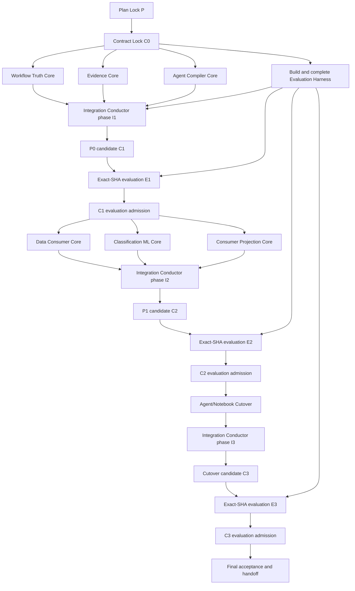

# Workbench v1.8.9 Contract-First Parallel Implementation Program

> **状态（2026-09-27）：部分采纳，不按本文件执行。** v1.8.9 已按 `objectives/2026-09-25-v1.8.9-objective.md` 在 `.worktrees/workbench-v1.8.9` 重建交付；本文件的并行 lane / Contract Lock / 独立 Evaluation Lane 组织方式未采用。下述条目的去向记录在 `followups/BACKLOG.md` §0.2（v1.8.9 延后与未实现）。
> 执行顺序（Workflow Truth → Evidence → Compiler → Data Consumer → Classification → QA）未采用；v1.8.9 按 objective 的 8 步 + 信任易用性轮 + 数字核对 + 手册交付。

> **For agentic workers:** REQUIRED SUB-SKILL: Use superpowers:subagent-driven-development (recommended) or superpowers:executing-plans to implement this plan task-by-task. Steps use checkbox (`- [ ]`) syntax for tracking.

**Goal:** 以 Contract Lock、3 条无共享写路径的 Feature Lane、1 条独立 Evaluation Lane 和单一-owner cutover/integration，把 v1.8.9 的正确性、数据消费、统一证据、自然语言编译和分类 ML 基础完整落地。

**Architecture:** 单一主 spec 是需求和统计语义权威；Contract Lock 冻结公共 refs、schemas、provider seam 和 canonical fixtures，package-local core 从同一 wave lock 并行开发。共享 registry/runtime/Agent/Notebook/Report 接线后置给单一 cutover owner，Evaluation 与 Integration 分离，最终 full gate 只认同一不可变 release-candidate SHA。

**Tech Stack:** Python 3.14、FastAPI、pandas、NumPy、SciPy、statsmodels、scikit-learn、React、TypeScript、Vitest、pytest、Workbench Graph/Agent/Notebook/Report contracts、formal devline control。

---

## Authority and non-negotiable boundaries

- 设计权威：`docs/superpowers/specs/2026-08-15-v1.8.9-ai-native-statistical-parity-foundation-design.md`。
- 并行协议：`docs/superpowers/specs/2026-07-18-adr-pd-001-parallel-development-protocol.md`。
- 本版本实现 P0/P1；P2/P3 只锁定扩展协议，不用模型数量掩盖基础层缺口。
- 当前 spec/plans 尚未形成 Plan Lock；在用户批准最终文档并产生干净 Plan Lock commit 前，不启动任何产品 devline。
- 每条开发线只能通过 `scripts/devline_control.py start` 创建；读取 `.agent/devlines/<line_id>/context-pack.md`、`.agent/development/global_rules.md` 和 Context Pack 选择的历史证据。
- provider 只能生成不可信 DraftAgentPlan；runtime 只接受服务器持久化 CompilationRecord 和有效 confirmation。
- 不允许 arbitrary Python/shell/network、自动安装依赖、静默 fallback、静默重试 mutation、Agent 自行批准算法、Evaluation 修改产品或 Integration 修改统计语义。
- push、PR、merge、tag、release 都需要用户另行批准。

## Plan set

| 顺序 | 计划 | 独立交付物 | 依赖/波次 |
|---|---|---|---|
| 0 | `2026-08-15-v1.8.9-contract-lock-implementation-plan.md` | ContractRef、ProviderContribution、public schemas、catalog、canonical fixtures | Plan Lock P；串行 C0 |
| 1 | `2026-08-15-v1.8.9-p0-workflow-truth-implementation-plan.md` | WorkflowState/PortBinding、family-aware post-estimation、真实 resume | C0；Wave A |
| 2 | `2026-08-15-v1.8.9-p0-evidence-projection-implementation-plan.md` | Evidence registry/projection kernel、fact validation | C0；Wave A |
| 3 | `2026-08-15-v1.8.9-p0-agent-compiler-implementation-plan.md` | Manifest graph、Descriptor、compiler、CompilationRecord、typed failure | C0；Wave A |
| E | `2026-08-15-v1.8.9-evaluation-harness-implementation-plan.md` | 先完成独立 harness；再按模板创建 E1/E2/E3 run lines 和 sidecar admission records | Harness：C0；Runs：每个 integration candidate 后 |
| 4 | `2026-08-15-v1.8.9-p1-data-consumer-implementation-plan.md` | Profile、metadata、safe AST、typed data operations、egress、UI component/provider | C1；Wave B |
| 5 | `2026-08-15-v1.8.9-p1-classification-ml-implementation-plan.md` | Logistic/RF、strict split/CV、metrics、DecisionPolicy、renderer/provider | C1；Wave B |
| 6 | `2026-08-15-v1.8.9-consumer-projection-implementation-plan.md` | Agent/Notebook/Report/UI bounded evidence projections、path coverage | C1；Wave B |
| 7 | `2026-08-15-v1.8.9-agent-notebook-cutover-implementation-plan.md` | 中央 registry/routes、Agent/Notebook/Report/UI 接入既有 admission/egress/evidence ports | C2；Wave C，单 writer |
| 8 | `2026-08-15-v1.8.9-foundation-integration-implementation-plan.md` | Conductor 生成 C1/C2/C3；E3 后独立 Final Acceptance line 写 browser/provider/full-gate sidecars | Conductor：P0+Harness 后；Acceptance：E3 admission 后 |

## Release-train DAG



默认最大并发为 4 个 subagent：3 个 feature writer + 1 个 independent evaluator。Integration conductor 不在 feature worktree 修改产品。第五个 subagent 只能承担只读审查、独立 browser runner 或完全无共享写路径的 fixture 工作；不能成为第四个中央文件 writer。

Evaluation Harness 实现线在首次 candidate evaluation 前必须完成并关闭。E1/E2/E3 是三个独立 formal run lines，各自只写唯一 Evaluation Manifest 和 sidecar admission record；它们读取同一冻结 harness/fixtures，但不修改 harness、candidate、golden 或容差。Candidate lock 文件不包含自己的 commit SHA 或尚未生成的 evaluation digest；sidecar admission 才绑定 exact candidate SHA + evaluation manifest digest，因此不会形成自引用 commit。

## Single-owner matrix

| 控制面/包 | 唯一写 owner | 其他 lanes |
|---|---|---|
| public contracts、provider loader/catalog、canonical fixtures | Contract Lock | read-only |
| `workflow.py`、`workflow_runtime.py`、post-estimation provider | Workflow Truth | read-only；Evidence 通过 interface/provider 接入 |
| `evidence/__init__.py`、`contracts.py`、`registry.py`、`projection.py`、`persistence.py` | Evidence Core | 其他 evidence 文件由后续明确 owner 写入 |
| planning/compiler/manifest/discovery/failure/compilation-record core | Agent Compiler | read-only |
| data profile/AST/operations/metadata/routes/provider/UI component | Data Consumer | read-only |
| predictive-research classification package/provider/renderer | Classification ML | read-only |
| evidence consumer adapters、results service、Notebook evidence、generic evidence UI、coverage | Consumer Projection | read-only |
| central workflow contracts/registry/adapters、operations/orchestrator/planning agent/agent routes、renderer mount points | Agent/Notebook Cutover | feature lanes forbidden |
| evaluation harness/tests/public fixtures | Evaluation Harness line | feature/integration forbidden |
| E1/E2/E3 unique manifest/admission/handoff | 对应 Evaluation Run line | candidate/integration forbidden；每个输出只有一个 run owner |
| C1/C2/C3 merge queue、integration-only harness/tests、conductor handoff | Foundation Integration Conductor | 不修 feature behavior；C3 前冻结 |
| browser/provider/full-gate sidecars、final handoff | Final Acceptance line | read-only C3；不得合并回 candidate |

以下文件不得出现在两个并行 Work Order 的 owned paths：

```text
backend/workbench/agent/workflow.py
backend/workbench/agent/workflow_runtime.py
backend/workbench/agent/workflow_contracts.py
backend/workbench/agent/context_compiler.py
backend/workbench/agent/notebook/planning_agent.py
backend/workbench/agent/workflow_capability_registry.py
backend/workbench/agent/workflow_capability_adapters.py
tests/test_workflow_runtime.py
tests/test_notebook_planning_agent.py
frontend/src/workbench/registry/sectionRegistry.ts
frontend/src/report/ReportView.tsx
```

共享测试拆成 lane-owned test files；Evaluation 只写 `tests/evaluation/v189/**`、`frontend/src/evaluation/v189/**` 和对应 immutable evidence manifest，不修改 feature expected values。

## Provider contribution contract

Feature lane 不通过中央 switch、prompt 特判或 UI 第二清单接入能力。每个 provider declaration 成组发布：

```text
identity/version/digest
  + operation/step/port refs
  + request schema
  + executor adapter ref
  + result validator ref
  + result/evidence projection refs
  + consumer renderer refs
  + safety/dependency/oracle refs
```

Provider catalog 只扫描固定仓库内 builtin provider package，稳定排序；duplicate、versionless、unresolved、digest mismatch、major incompatibility 都 fail closed。注入第三个 fixture provider 后，Manifest、Descriptor、compiler 和 coverage 应自动出现相应 path；不能要求修改 Notebook planner、通用 UI 或 compiler 分支。

## Plan Lock and Contract Lock protocol

- [ ] **Step 1: classify current dirty planning state**

记录 `git status --short --branch`、`git rev-parse HEAD`、`git rev-parse origin/main`。当前 modified/untracked spec/plans 属于 planning work，不能被当成 implementation baseline。

- [ ] **Step 2: finish and review all plans**

运行 spec coverage、placeholder、path collision、line-id/path accuracy 和显式 Markdown whitespace scan。把全部目标 planning files 暂存后运行 `git diff --cached --check`；普通 `git diff --check` 不覆盖 untracked plans。Plan Lock 之前不得创建 feature objective/devline。

- [ ] **Step 3: request Plan Lock authorization**

只有用户批准 commit 后才把最终 spec/plans 形成干净 Plan Lock P。commit/push 是不同权限；Plan Lock 不授权 push。

- [ ] **Step 4: execute Contract Lock plan serially**

Contract Lock 从 P 建独立 integration worktree 和正式 devline。C0 必须包含真实 schemas/fixtures/provider seam 和 passing compatibility tests，不允许仅用接口草图冒充 lock。

- [ ] **Step 5: create wave worktrees from one exact lock**

每个 Work Order 记录 release baseline、integration base、wave lock、branch start；首波必须满足：

```text
HEAD == branch_start_commit == C0
```

后续 wave 分别从 C1/C2 开始。feature lane 不从其他 feature branch pull/rebase；合同变化产生 C(n+1)，禁止同 wave 混用。

## Work Order and Completion Report

每条 lane 在 implementation 前创建固定路径 Work Order，至少包含：

- objective、non-goals；
- exact 40-character baseline/wave-lock SHA；
- owned files、read-only contracts、forbidden files；
- provider/contract inputs和 outputs；
- focused tests、mutation、known gates；
- formal line id、worktree、branch；
- completion report 路径和 rollback 方法。

`affected-path`/`allowed-path` 只能列精确文件或单-owner package；禁止 `backend/workbench`、`tests`、`frontend/src` 等宽根。Work Order 与 child plan 不一致时停止，不得靠临时 rescope 扩大职责；真正遗漏只能经显式 review 和 `rescope-context` 修正。

Completion Report 必须记录 baseline、wave lock、tip SHA、exact diff、tests、mutation、formal verification、known limits、NOT VERIFIED、rollback。没有 Completion Report 和独立 Evaluation Evidence Manifest 的 tip 不进入 merge queue。

### Mandatory FMS template inherited by every child plan

每个 Work Order 的 Task 0 和 closeout 必须逐字继承以下边界，不能因为 child plan 未重复展开而省略：

- start 前完整读取 `.agent/devlines/<line_id>/context-pack.md`、`.agent/development/global_rules.md` 和 Context Pack 选择的全部 retrospectives/evidence；
- 开发期间把每个 material `FAILURE`、`ERROR`、`GAP`、`WASTE`、`REVIEW`、`GATE`、`STATE_CHANGE` 及时通过 formal CLI append 到 `events.jsonl`，不能等 closeout 一次性补写或只留在聊天；
- scope 不准确时停止，通过 `rescope-context` 及完整 repeatable allowlist 修正；不手改 Context Pack、manifest 或 `.agent/devlines` 文件；
- closeout 前运行 formal context/event verification，通过同一 CLI 生成 retrospective，再记录最终 state change；
- FMS process verification 不替代 model、containment、browser、performance、provider 或 release evidence。

## Gate layering

### Lane-local gate

- red/green TDD；
- focused and impacted regressions；
- canonical contract fixtures；
- numerical known-truth 或明确 validation level；
- mutation anchor；
- `git diff --check`；
- exact scope-owner check；
- formal event verification/retrospective。

Lane-local gate 不宣称 browser/provider/full-gate/release pass，默认不重复运行 `bash scripts/gate.sh --full`。

### Wave integration gate

- 合流后的全部受影响 focused suites；
- cross-contract compatibility 和 legacy replay；
- registry/catalog/path-level coverage；
- relevant frontend tests/typecheck；
- 中央 workflow/registry/security 变化时的 full backend/golden subset；
- 新 evaluated commit 的独立 Evidence Manifest。

### Final release-candidate gate

- final independent evaluation；
- fresh isolated browser acceptance；
- provider benchmark 若获批，否则 NOT VERIFIED；
- formal verification；
- `bash scripts/gate.sh --full`；
- evidence-layered handoff。

最终 full gate 后任何 product、contract、registry、fixture、test、golden 或 gate 变化都会使证据失效，必须在新 candidate SHA 重跑。

## Conflict and contract-change protocol

- 机械冲突仅限 import/order/provider declaration；Integration 可在单独提交解决并使相关 evaluation 失效重跑。
- 统计、runtime、confirmation、Graph、安全、数据 identity、UI state 等行为冲突必须退回 owner lane。
- 公共合同不够表达需求时，lane 记录 GAP 并停止，提交 Contract Change Request；禁止 payload 私塞字段或 feature branch 改公共 schema。
- Contract Change Request 必须列 version change、兼容性、fixtures、消费者、migration、evidence invalidation 和 rollback。
- Evaluation 失败只能由 feature owner 修复；Evaluator/Integration 不得提高容差、更新 golden、删除 case 或把 blocked 改成 success。

## Program exit gates

1. Gate P/C：Plan Lock、Contract Lock、single ownership 和 canonical fixtures 完整。
2. Gate 0：Workflow/Evidence/Compiler core 与独立 P0 evaluation 通过。
3. Gate 1：Data/Classification/Consumer Projection core 与独立 P1 evaluation 通过。
4. Gate 2：Agent/Notebook/Report/UI cutover 只有一套 registry/compiler/runtime truth。
5. Gate 3：自然语言 discovery/compile/confirm/execute/evidence 的 path-level matrix、holdout 和 adversarial evaluation 通过。
6. Gate 4：browser、provider boundary、formal、final full gate、handoff 分层完成。

No P2 family implementation begins before Gates P/C–3 are satisfied. Gate completion is evidence tied to an exact commit, not a calendar milestone or capability count.
