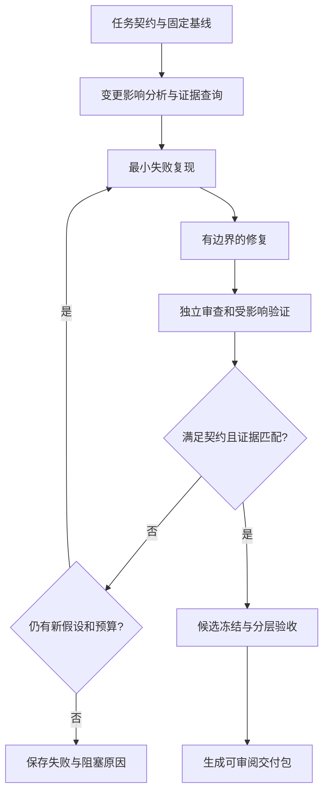

**Arboris v1.9.1 代码风险审查与开发效率建议**

审查日期：2026-11-06（America/New_York）。范围由用户确认：最新 v1.9.1 工作区，包含未提交改动。基准 HEAD 为 `da011743b68770224bfc91a98b207784108b7b47`。这是跨模块风险审查与离线调试，不是整版发布验收，也没有实施产品修复。

结论：应先修复出站隐私、并发导出和表格解析依赖问题，再完成性能与统计协议收尾。当前最大风险来自模块边界：内容换了一种 JSON 形状后隐私规则失效、并发任务共享临时文件、审计身份没有涵盖实际科学规格。继续增加方法数量无法消除这些风险。

本次给出 11 项发现：4 项 P1、7 项 P2。其中 9 项有合成数据或可控并发的运行证据，1 项为已核实版本与官方漏洞公告对应，1 项为工程控制缺口。没有确认 P0；这不意味着其他路径不存在高危问题。

P1 表示建议作为本次发布前修复项；P2 表示应排入近期修复，或明确限制适用范围。优先级是本次工程判断，不等同于 CVSS。发现 5 涉及未提交的原生 I/O；其他具体根因存在于已提交代码。审查过程开始时有其他工作改变暂存状态，因此证据同时绑定文件内容哈希，不能只用 HEAD 代替工作区身份。

| 编号 | 优先级 | 问题 | 主要影响 | 证据 |
|---|---|---|---|---|
| 1 | P1 | 图表 Ask AI 未正确应用项目出站策略 | 受限原始值进入模型请求 | 真实组装与模拟 HTTP |
| 2 | P1 | 频数表绕过列值脱敏 | 姓名外发，审计仍显示已脱敏 | 真实计算、投影与模拟 HTTP |
| 3 | P1 | 并发导出共享 staging 文件 | 成功响应与文件内容不一致 | 真实 writer、可控线程交错 |
| 4 | P1 | xlsx 0.18.5 读取外部文件 | 已知原型污染／拒绝服务风险 | lock、安装版本、可达入口、官方公告 |
| 5 | P2 | 原生 CSV 为每列分配固定浮点缓存 | 宽表额外占用大量内存，甚至更慢 | 小型合成表、独立进程观测 |
| 6 | P2 | 数据分页命中缓存前仍读整表 | 翻页成本随完整数据量增长 | 连续分页与解码次数计数 |
| 7 | P2 | 空闲事件轮询仍解析全部日志 | 长会话持续耗 CPU、延迟增长 | 无新增事件的合成日志复现 |
| 8 | P2 | 预测身份未包含目标／特征规格 | 不同分析使用同一审计身份 | 三个结果不同的真实预测运行 |
| 9 | P2 | 负对照全表置换跨越留出边界 | 隔离声明不成立，控制指标改变 | 只改留出标签的差分实验 |
| 10 | P2 | 多估计目标被单目标完成契约拒绝 | 合法任务无法保存完成计划 | 真实 update_plan 工具调用 |
| 11 | P2 | 环境与工作区验收身份不足 | 无法可靠复用证据、未来安装漂移 | 依赖声明与 gate 记录代码 |

**1. 图表解释可以把受限原始值发给模型**

入口是当前界面的图表 Ask AI：`TableViewFigures.tsx:148` → `figureAi.ts:39` → `/llm/chat`。时间趋势上下文可含最多 400 条逐行数值。`backend/workbench/http/llm_routes.py:968` 没有绑定项目出站作用域；同文件 1331 行又把 packet 拼在自然语言系统提示后面。`backend/workbench/egress.py:556` 只把完整 JSON 字符串作为结构化内容解析。

合成项目配置 `remote.allow=[]`、`salary=restricted` 后，真实请求组装送到本地 MockTransport 的 payload 仍包含合成薪资 `7654321.123`，审计记到用户级目录。即使在复现中补上正确项目作用域，原值仍保留，项目审计显示未扣留内容。点击“解释图表”没有授权覆盖受限列规则；图片单独 opt-in 也不等于数值外发授权。

建议同时修复两层：由服务端验证项目身份并绑定出站策略；在序列化为提示文本之前过滤有明确类别、列来源的结构化 packet。逐行图表值应按原始行分类，默认发送汇总。只补 `egress_project` 不足以修复。

验收：对真实路由及最终 HTTP 请求体断言禁止值完全不存在；覆盖拒绝全部远程内容、受限列、图表数值、图片选项、正确项目审计与报告重试路径。本次实际复现的是图表模式，不据此宣称所有报告均已发生泄漏。

**2. 频数表泄漏姓名，日志却提示已脱敏**

`backend/workbench/agent/context_tools_support/summaries_public.py:128` 把 tabulate 的 `rows` 改名为 `frequencies`，按汇总结果允许外发；但条目仍含 `{variable: "name", value: "姓名", count: ...}`。`backend/workbench/egress.py:359` 的列识别依赖 dtype、type 等字段，不能识别这个结果结构。

沿真实统计计算、公开结果投影和 LLM 请求组装，配置 `name=restricted` 后，模拟发送体保留 `SYNTHETIC_PERSON_ALPHA/BETA`。审计却记录 `redacted_columns=["name"]`，因为它只遮蔽了旁边的 `variables.name`。

通俗地说，“张三出现两次”虽然是统计汇总，仍然包含张三的身份。不能把“是汇总”当成“已匿名”。

建议给统计结果显式保留列归属和敏感性，按类型契约处理频数值、分组标签、列统计和模型输出。审计状态应与实际过滤结果一致。对于受限分类值，先扣留类别原值；小样本计数抑制可以后续作为更严格策略，不能替代基本列权限。

验收：使用真正 tabulate 生产的结果，检查最终发送字节，覆盖频数、分组、列别名和本地／远程策略。不要只断言日志里出现 redacted。

**3. 并发导出可能返回别人的列**

`backend/workbench/services/data_export.py:195` 的临时名只由节点和格式组成。同节点同时导出不同列，会共用 staging；后续计算摘要与移动文件之间也没有请求隔离。

复现保留真实写入器，仅用线程事件安排合法交错：A 写列 a，B 写列 b，A 再发布文件。A 成功响应声称导出 a，实际文件表头是 b，首值为 100；B 随后报 FileNotFoundError。这比普通“导出失败”更严重，因为 A 看起来成功。

建议每个请求持有唯一临时目录／文件句柄，所有子 `.part` 文件也归该请求。摘要计算、发布和报告绑定同一份字节；同一最终 artifact 的登记需要串行化或事务式幂等。不能只在最后一次 rename 前加锁，因为此前已可能串写。

验收：两个不同列选择、相同节点／格式／文件名的导出并发进行，各自报告、文件字节、摘要和注册 artifact 必须一致；同时覆盖取消与失败清理。

**4. 表格预览直接使用有已知漏洞的 xlsx 0.18.5**

`frontend/package.json`、lock 和当前安装版本均为 0.18.5。`frontend/src/api.ts:613` 在真实文件预览入口调用该解析器。SheetJS 官方公告确认此版本处于 CVE-2023-30533 原型污染与 CVE-2024-22363 正则拒绝服务的受影响区间。后者官方修复门槛是 0.20.2；这不是对某个版本“永久无漏洞”的保证。[官方原型污染公告](https://cdn.sheetjs.com/advisories/CVE-2023-30533)、[官方拒绝服务公告](https://cdn.sheetjs.com/advisories/CVE-2024-22363)。

此外，601–622 行先读完整文件，再在浏览器主线程解析工作簿、转换整张表；为获取表头还调用一次 sheet_to_json。后续 columnStats 又逐列创建多份数组。即使文件没有恶意内容，大表也可能让界面长时间无法响应。动态 import 只延迟加载库，不会把解析移到后台线程。

建议选择经审查且修复相关公告的发行源，锁定完整性，补依赖审计；不要假设 `npm update xlsx` 自动解决。解析放入可终止 Worker 或受限后端进程；限制压缩后／解压后大小、单元格数和时限；预览按需抽样，完整统计走有进度的独立任务。

本次没有执行恶意文件攻击，也没有证实任意代码执行。验收应包括已知漏洞回归、普通大表、压缩膨胀输入和取消后资源回收。

**5. 新原生 CSV 在宽表上出现明显内存退化**

未提交的 `native/io_writers/io_writers.cpp:35` 每个 TextCache 预分配 4096 项；722 行给所有列创建 ReprCache，包括完全不需要浮点 repr 的布尔列。该平台三组容器初始约为每列 102,400 字节，还不含后续字符串。

1000 列、1 行的布尔 DataFrame 仅约 1.1 KB：参考路径峰值 RSS 为 104,398,848 字节，native 为 205,553,664 字节。1000 列、100 行时，native 峰值约 227 MB，而参考约 105 MB；输出字节相同。10 列多行时 native 更快，说明问题与表形状相关，不能用单一长表结果证明普遍改善。

这是单次进程诊断，用于确认分配机制，不是独占宿主的正式性能 A/B，也没有实际触发 OOM。

建议只为需要且有重复收益的浮点列懒分配，按行数／基数定容量，设置每请求总字节上限，避免每块重新预留整份列缓存。验收覆盖高列低行、低列高行、混合类型和高基数，分别检查字节等价、时间与峰值内存。

相邻静态风险：`backend/workbench/export_writers.py:272` 的 DTA 分块固定为 65,536 行；1,000 个 double 列仅单块输出就约 500 MiB，尚未计输入和额外副本。应按目标字节数与行宽决定块大小。本次没有进行该大内存实测，不将其称为已发生 OOM。

**6. 数据分页的缓存命中并没有避免整表解析**

`backend/workbench/services/dataset_view.py:79` 先解析 cast context，85 行才查 LRU。`data_operations/casts.py:100` 调用的实现会在 168 行计算完整文件摘要，172 行解码整表，再把 DataFrame 丢弃。接着页面缓存可能再次解码。

20 行合成 CSV 连续请求三页、每页 5 行：首个请求全表解码 2 次，后续两次即使缓存命中也各解码 1 次。分页限制控制的是返回量，未控制读取成本。LRU 还按“最多八张表”而非字节预算保留整表。

建议把可信元数据解析与载入数据分开；使用已有不可变 artifact 身份、经过验证的文件句柄和受控失效机制复用校验，不能简单删除完整性检查。为缓存设置字节预算与项目关闭清理；大文件优先列裁剪、Parquet row group／批读取。

验收：同一已验证数据翻页不重复完整解码；源变化仍被拒绝或重新验证；多项目并存的缓存总字节有上限。

**7. 长会话空闲时也会重复解析全部事件**

`backend/workbench/agent/events.py:157` 先 `_read` 整份 JSONL 再过滤 after_seq；166 行完整 read_text。前端 `AgentSurfaceContext.tsx:462` 在空闲状态仍每轮等待 500 ms 后继续轮询，666 行还会在事件游标变化时刷新计划及 turn 状态。

没有新增事件、返回 0 条的合成复现：

| 历史事件数 | 每次 JSON 解析次数 | 文件大小 | 三次诊断中位耗时 |
|---|---:|---:|---:|
| 1,000 | 1,000 | 约 0.19 MB | 2.1 ms |
| 10,000 | 10,000 | 约 1.95 MB | 22.3 ms |
| 50,000 | 50,000 | 约 9.83 MB | 118.2 ms |

耗时是当前环境观测；确定性结论是读取与解析量随全部历史增长，而非随新事件增长。写入端已经有 tail 优化，不能据此推断读取端也已解决。

建议添加 sequence 到 byte offset 的可重建索引、分页和增量读取；更大规模可评估 SQLite WAL。传输改成 SSE／长轮询，空闲及后台标签退避；仅相关事件刷新计划。更换存储前保留崩溃恢复、顺序和重复事件约束。

验收：追加少量事件的读取成本基本不随旧日志增大；断线重连不丢不重；无事件时不重解析全部日志。

**8. 不同预测规格得到相同身份**

`backend/workbench/predictive_research/identity.py:72` 纳入 sample/split、model_type 和 model_id，却未完整纳入目标 y、有序特征 x 和预处理设置。`prediction.py:151` 使用该身份，图节点也派生相应哈希。

同一数据和划分运行三个规格，分别替换特征、替换目标：预测值不同，prediction_identity_hash 与 run_identity_hash 却相同；后两次显示 prediction_hit=True。

当前缓存明确是 identity_only，compute_skipped=False，每次仍重新计算。本次没有证实旧预测结果被错误复用或文件被覆盖。已确认的是审计身份碰撞；若未来基于该键做结果复用，风险会进一步放大。

建议定义规范化的完整 PredictionSpec，至少涵盖 y、有序特征、估计器参数、预处理／插补、权重、数据和划分身份、随机种子及执行器版本。身份格式升级应版本化，旧身份不得冒充新规格缓存。

验收：任意会改变计算的问题设定变化必须改变身份；仅显示名称变化保持可解释的复用语义。

**9. 负对照跨越留出边界，且仍声明开发集隔离**

`backend/workbench/predictive_research/prediction_protocol.py:426` 在全体标签上置换，491 和 596 行才取训练索引，因此留出集标签可能被换进负对照训练。630、710 行附近仍写 development_only 和 final_holdout_isolated。

复现只改变最终留出集的 y：主模型 development CV 不变，但负对照 development CV 改变。训练捕获值证明来自留出集的合成标签进入了负对照训练。

这不是“主模型已泄漏”的证据。全局置换在某些统计检验协议中可以有合理用途，但与这里公开的开发集隔离语义不一致，并会影响用来判断协议是否可靠的控制指标。

建议先明确负对照的科学协议。若承诺开发集／fold 隔离，应在每个训练范围内置换，并保持验证及留出标签只参与评估；若选择其他置换检验，应采用对应推断协议并准确披露，不复用隔离声明。

验收：只改留出标签，不改变开发阶段负对照的拟合输入及 CV；时间与分组数据另测相应边界。

**10. 合法的多目标问题会陷入无法完成的状态**

用户要求“同时估计 ATT 和 ATE 并比较”时，任务绑定了两个目标。`backend/workbench/agent/task_requirements.py:116` 却把目标集合与单一 estimand 集合做严格相等判断，而 completion.target 只表示一个目标。

真实 update_plan 离线调用中，省略 target、选 ATT、选 ATE 均 saved=False；即使其他交付条件完成，检查仍为 partial。这是契约表达能力不足，增加模型推理次数无法解决。

建议支持 targets 列表与逐项目证据覆盖。旧单目标计划可迁移为一个元素；所有目标都有有效证据才完成。短期应预检并明确说明边界，可将任务拆成保留共同父问题的多个子计划，不能无声缩小用户问题。

验收：单目标、多目标、其中一个未完成、重复目标、用户修订以及“目标已完成但比较未完成”的状态各有清晰结果。

**11. 测试证据与可重建环境尚未统一绑定**

`pyproject.toml:10` 起的多数 Python 依赖只有下限，未找到应用级 Python 锁文件；`scripts/gate_metrics.py:84` 的标准摘要记录 HEAD，却不记录完整工作区树、依赖、解释器／平台及 native 构建身份。当前其他评测脚本存在更严格的单独回执，因此问题是标准 gate 摘要不能独立证明完整环境身份，不是整个项目没有任何身份机制。

共享环境有利于节约磁盘，但升级后会同时改变多个 worktree 的运行环境。相同 HEAD 加不同 dirty 内容，也可能给出形式上相同的 HEAD 证据。三个月后重新安装，旧的“测试通过”未必能复现。

未提交的 `scripts/perf_native_io.py:182` 也只记录 HEAD；worker 失败会写入 returncode，但父进程不因此判定整体失败，且 199 行删除 scratch。它可以用于诊断采样，不能仅凭脚本退出成功当成数值、噪声、资源门全部通过。作为正式 gate 前，应补身份、明确判定与失败产物保留。

建议维护经验证的应用环境锁定方案；共享依赖按 lock 内容寻址，使已验收环境保持不可变。统一生成证据键：完整源码树摘要（含 staged／unstaged／参与构建的 untracked）、测试选择、依赖锁、解释器／OS／架构、native 构建回执、输入数据哈希及门槛版本。运行前后核验树是否变化。复用证据只在键与适用条件相符时发生。

验收：新目录离线／受控安装能重建同一环境；修改未提交代码、依赖或 native 二进制会使对应证据失效；不同层级证据不会被误汇总成完整发布通过。

**已有保护与本次边界**

已看到并核查 API Host／Origin／跨站写入保护、主要 artifact 路径约束、未知工具默认禁止出站、无效策略拒绝、审批修订／指纹绑定、持久 turn 和恢复结构，以及 native ABI／构建身份检查。这些基础应保留并修补接口处的问题。

没有把长文件本身当 bug，也没有把 pandas 的所有投影都当成深复制。没有运行付费模型、评委、正式留出集、完整宿主 gate 或真实浏览器验收。一次沙箱合成子进程检查被宿主 sandbox_apply 拒绝，不能据此认定产品隔离失败。未全面验证跨平台内存安全、所有 C++／Rust 路径或所有统计方法。

当前 progress 与 acceptance 文档仍保留 M5／真实 Agent、M2 浏览器及部分性能资源门开放状态。本次审查不替代这些门。发现中的耗时／RSS是诊断观测，不升级为正式性能认证。

**如果三个月后失效，最可能的原因**

我的首要判断是：方法与入口不断增加，统一契约及发布证据的扩展速度跟不上。一个字段改名、一条新调用路径、一次并发请求，就让局部正确的模块组合成错误的整体。出站频数与图表问题、导出串写、多目标死路已经提供了具体例子。

第二个可能原因是日常数据规模和使用时长超过开发样例：长会话、宽表、多项目缓存、并行导出叠加，导致“计算内核很快，但整条工作流越来越慢”。第三个是环境与候选漂移：可重现性依赖同一台机器上的共享环境，真实评测与最终交付候选没有保持一致。

建议按未来 90 天管理领先指标：每新增能力需要修改多少独立映射；最终请求中禁止数据的出现次数；成功导出但字节／报告不一致次数；长会话每次增量读取字节；每页完整解码次数；常驻／峰值内存；同一证据被重复生产的次数；未闭合门数量及滞留时间。不能只看测试总数和新增功能数。

**如果主动增加三项功能，我会这样选择**

以下是基于现有能力的产品设计建议，目标是形成领先体验，尚未证明市场独有或领先，也不是批准实施清单。

1. **可携带、可独立验算的研究包。** 在现有血缘和报告证据之上，一键导出研究问题、审批规格、数据摘要、变换 DAG、环境／native 身份、计算结果与验证命令。接收者可以不调用 LLM 独立重放并检查结果；私有原始数据默认留在本地，缺少数据时清楚显示验证边界。关键增量是“跨机器独立核验”，而不是再保存一份历史。DVC 已提供实验与流水线复用的成熟做法，可借鉴其内容身份和 run cache 思路。[DVC 实验管理](https://doc.dvc.org/user-guide/experiment-management)

2. **研究反证实验室。** 复用现有稳健性与负对照能力，把“这个结论在什么情况下会失败”做成统一工作流：训练范围内置换、时间／群组泄漏探针、缺失处理敏感性、安慰剂、异常样本和已知真值合成数据。预先固定检验协议，输出结论在哪些假设下稳定、在哪里失效；不能按显著性挑结果。关键增量是自动构造有判别力的反例，并按科学协议验证，不是让第二个 LLM 给主 Agent 打分。

3. **带资源预算与故障定位的 Agent 控制台。** 在现有步骤、用量和恢复记录之上，把一次任务的模型等待、数据读取、计算、写盘、验证分别展示；执行前给出时间／内存／外发范围预估，执行中按总资源预算排队，出错定位到第一个失败的边界，并提供已验证的恢复点。观测日志可离线重评分，避免每次都重跑模型。MLflow 官方文档已有复用执行轨迹进行评估的路径，可借鉴而无需立刻引入整个系统。[MLflow 轨迹评估](https://mlflow.org/docs/latest/genai/eval-monitor/running-evaluation/traces/)

优先顺序建议为：先完成本报告 P1 修复；再做研究包所需的完整身份；随后做反证实验室；控制台按现有痛点逐步扩展。三项都应服务研究可信度与可操作性，避免同时增加大量不相关模型。

**提高开发效率的三种做法及自动化 loop**

| 做法 | 适合阶段 | 收益 | 代价／边界 |
|---|---|---|---|
| 契约驱动的能力注册 | 每次增加统计方法／Agent 工具 | 一个声明派生 UI、CLI、工具规格、权限与证据检查 | 科学验证不能仅由自身声明生成 |
| 证据缓存与分层验证 | 现在即可实施 | 减少重复测试、模型调用和全门开销 | 必须准确判断变更影响与证据失效 |
| 有预算的自动修复 loop | 上述两项稳定后 | 从复现到候选补丁与审查可持续自动运行 | 必须限制重试、资源和测试自我迎合 |

推荐先做第二项，同时在新增能力时完善第一项，再逐步放开第三项。当前 gate.sh 的 quick 主要针对未提交 diff，不足以独立充当跨提交自动 loop 的变更选择器；loop 必须有固定基线与候选身份。

建议循环如下：

循环的具体规则：

1. 输入必须包括目标、非目标、准确 baseline、允许路径、保护路径、成功判据、测试选择、资源／调用预算和停止条件。沿用每版本一个正式开发线，不按切片或审查另开线。已有 Context Pack 管的任务不再重复写规划文件。
2. 先查询已有证据。键相同且证据仍适用时复用；失败原件永久保留，修复结果追加。实时模型／环境波动等证据设置单独适用期，不能无限期缓存。
3. 首先制造能区分假设的失败。本报告中的最终发送体、两请求交错、留出标签扰动，优先级高于“函数能返回一个对象”的测试。
4. 实施 Agent 只修改批准范围。独立审查者检验边界与反例；不能通过改期望值、降低门槛、删除失败样例或自动消费 held-out 获得绿色结果。
5. 自动运行按层分配：静态与聚焦测试 → 真实公共入口离线回放／独立数值参考 → 受影响浏览器检查 → 冻结候选的宿主 full gate／资源门。真实 Provider、评委、正式留出、外发、发布依原有授权单独设门。离线回放证明确定性集成，不证明模型在新问题上的推理质量。
6. 建议默认每个根因最多三次有不同证据支持的修复尝试；无新信息就停止循环，不把同一失败连续重跑。用 CPU、RAM、磁盘和独占性能槽管理并发，不只按 Agent 数量启动工作。只读审查可以并行，共享产品文件与正式事件追加由单一拥有者协调。
7. 成功输出包括补丁、源码／环境身份、最小复现、验证范围、未覆盖门、风险和回退方案；通过正式 CLI 追加 material REVIEW／GAP／GATE，FMS 验证仍只证明过程完整性。

衡量 loop 是否有效：从首次复现到可审阅候选的时间、首次通过率、逃逸缺陷率、每个已验证修复的模型成本、重复执行比例、人工接管次数，以及 p95／内存是否退化。代码行数、自动重试次数、单纯测试数量都不适合作为成功指标。

落地顺序可按依赖安排为四批：先关掉隐私和数据串写风险并修复受影响解析依赖；再修身份、目标契约和负对照；随后治理宽表、分页、事件读取；最后把已形成的复现与证据规则接入自动循环。具体工期需要用上述复现评估补丁后确定，不在审查中虚报完成时间。

**证据位置与复查方式**

全部归档于仓库 `local/audit-20261106/`，为本地忽略目录；报告入库不意味着这些证据自动随 Git 分享。`evidence-index.json` 给出文件摘要，`source-manifest.json` 绑定审查时的源码。安全复现只用合成数据和 MockTransport；性能复现使用小数据和真实 writer；统计复现使用明确区分目标的合成数据。脚本保留原临时目录路径，重跑前应在新的 scratch 目录执行，避免覆盖既有证据。

- `security/repro_egress.py`、`.out`：发现 1。
- `security/repro_sensitive_frequency.py`、`.out`：发现 2。
- `performance/service_probe.py`、`service_probe_results.json`：发现 3、6。
- `performance/csv_probe.py`、`csv_probe_results.json`、`source_snapshot.json`：发现 5，含实际 native 构建身份。
- `event-replay.json`、`reproduce_event_replay.py`：发现 7。
- `correctness/reproduce.py`、`evidence.json`：发现 8、9。
- `correctness/reproduce_multi_target.py`、`multi-target-evidence.json`：发现 10。
- `security/repro_descendant.out` 与 `performance/setup_failure.txt`：保留未成功的环境探测，不计为产品缺陷证据。

本次未修改产品代码、测试或现有用户改动，没有安装依赖、提交、合并、推送或发布。正式开发线只追加本次审查事件；这些问题仍待修复和相应回归。
