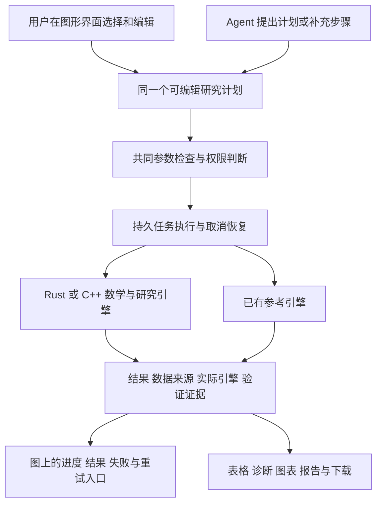
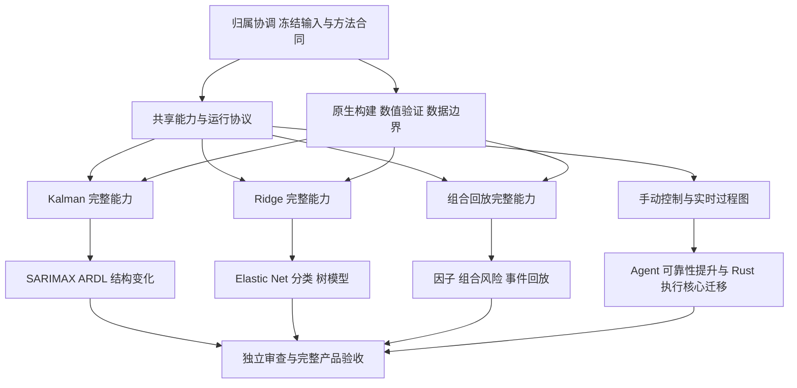

# Arboris 原生计算与 Agent 持续开发总规划

日期：2026-11-05。面向用户的规划与后续协调者的执行依据。

## 1. 目标与当前交付

**让 Arboris 成为能够完全手动、单机使用的研究工作台。数学计算逐步由 Rust/C++ 承接；Agent 操作同一套能力；用户能在图上看清、干预和复现每一步。**

持续开发的产出单位是“经过验收的研究能力”，不是函数、注册项或模型名称。新增算法从 Rust/C++ 实现开始，接通图形界面和 Agent 后才进入正式能力清单。历史 Python 参考实现保留作兼容路径与独立对照，直到对应替换具备完整证据。

这份文件交付长期路线与第一批任务安排，不宣称这些功能已经开发完成。本轮已使用三个子代理并行审查，并复用它们评审规划。没有启动新的后台开发服务或定时任务。

## 2. 真实起点与已有授权

- 代码审查位置：`/Users/jiayuanren/项目规划/.worktrees/workbench-v1.9.1`。
- 开始审查 HEAD：`f05e480fba23aa0ce971ab761cb12489a511f754`；审查期间其他工作推进到 `4ae597b16a0bd7133c771790ce3fb15a17455106`，仍有未提交改动。因此这里是动态调查，不是实施冻结快照。
- 现有正式开发线是 `v1-9-1`；其原始版本基线为 `402d2d3eac3695d836255a424372930850b73a95`。不要把三个不同用途的 SHA 混成一个。
- 完整 objective 的 2026-10-29 补充已经授权数学引擎和 Agent 本地管线原生重写；2026-11-05 补充已经授权局部水平状态空间、原生 Ridge、带费用组合回放及共同手动/Agent 入口。这些已授权工作直接接续，不重复征求许可。
- `native/time_series`、`native/ridge`、`native/quant_replay`、适配器及测试正在其他执行者手中推进。先登记任务归属和证据，再补缺口，不另写一套覆盖它们。
- Agent 已有 Python Core、类型化操作请求、权限、计划版本、持久事件及恢复机制。重点是完善这些机制和手动/图形界面的贯通，不从零重建整个 Agent。
- 已有 ARIMA、ETS、VAR、VECM、GARCH 等时序实现。新增覆盖须按参数、诊断、预测、入口和验收分别核对，不能只搜到名称就判定完整。

**版本规则：同一发布版本只有一条正式开发线。** 工作包、子代理、临时隔离 checkout 都不是新的正式线。范围变更只由协调者通过 `scripts/devline_control.py rescope-context` 记录；新版本只能由该 CLI 的 `start` 创建。受保护路径的例外不得扩展到整个目录。

## 3. 采用哪种推进方式

| 方式 | 主要结果 | 选择 |
|---|---|---|
| 一次重写所有 Python，并同时铺开所有模型 | 很长时间只有半成品，数值与界面回归难定位 | 不采用 |
| 只给现有 Python 外面加接口 | 覆盖较快，但不能兑现自主原生引擎目标 | 仅保留作参考和过渡 |
| 原生核心逐项开发，每批交付完整研究流程 | 每一批都能实际使用，逐步减少 Python 计算依赖 | **采用** |

第一轮维持一名主协调者、最多三个并行工作代理，符合本次运行环境容量。计算量大的验收单独排队。提高并发应以冲突率、等待时间、主机资源和验收吞吐改善为依据。

## 4. 最终架构

| 层 | 技术方向 | 责任 |
|---|---|---|
| 数学核心 | 新模块以 Rust 为主，复用已有 C++ 模块和成熟原生基础库 | 线性代数、优化、概率、模型、数值诊断 |
| 数据与计算边界 | 有版本的类型协议、连续列缓冲、缺失掩码、样本引用 | 避免重复复制和把百万行数组变成 JSON |
| Agent 执行核心 | 先固定共享协议，再逐项迁移需要的部分到 Rust | 任务调度、进程隔离、事件、取消、恢复、权限 |
| 参考与适配层 | Python | 保持已有功能，做轻量桥接与独立对照；不是新数值算法的默认实现语言 |
| 可视界面 | React/TypeScript | 表单、计划、过程图、结果与手动控制 |

Rust 的优先价值包括运行效率、资源控制和内存安全；换语言本身不会缩短远程 LLM 的思考时间。无需先把 Python Agent 重写成 TypeScript 再重写成 Rust。

原生化不等于重新发明 QR、SVD、随机数和所有基础数学。先复用可审计、许可合适、已安装的原生基础设施；新增依赖仍按项目现有规则办理。自主实现标准方法与发明新统计方法分开管理；后者进入实验研究区，不能自动成为正式能力。

## 5. 能力状态必须看得懂

每个方法保留独立的能力卡：方法 ID、用途、参数、输入限制、实现语言、参考/原生引擎、手动入口、Agent 入口、测试证据、版本与负责人。

| 状态 | 允许怎么描述 |
|---|---|
| 已列入路线 | 有方法说明，还没有运行证据 |
| 内核在建 | 有源码或局部测试，尚未完整接入 |
| 已注册/已接线 | 系统可发现，不能据此声称计算成功 |
| 手动可运行 | 有断开 LLM 后的真实 GUI 执行证据 |
| Agent 可运行 | 经同一操作协议实际执行；离线回放与真实 Provider 分别标记 |
| 已验证 | 该方法声明范围内的数学、边界、恢复、性能和浏览器证据齐全 |
| 正式可用 | 已纳入待发布候选并通过产品准入；发布状态另列 |
| 已发布 | 有明确发布版本和授权记录 |

手动、Agent、数值、性能、浏览器等维度分别存证，不能用一个总绿色状态掩盖缺项。能力总数、操作数、模型家族数和原生模块数分开统计。

## 6. 统计研究版图与优先级

这是常见实证研究的覆盖地图，不声称穷尽统计学。已有、在建、未找到实现与尚未验收必须分开。优先级还要考虑真实使用场景、共享基础收益、可验证性和现有在建工作。

| 优先级 | 研究问题/模型组 | 已有基础或当前情况 | 后续补强目标 |
|---|---|---|---|
| P0 | 所有研究的可靠基础 | 已有统计检验、缺失处理、工作流与结果体系 | 时间/样本身份、缺失与权重合同、共享运行控制、能力卡与证据、稳定原生构建 |
| P1 | 时间序列：趋势、季节性、预测 | 已有 ARIMA、ETS、VAR/VECM、ARMA/GARCH；local-level 原生在建 | 先完成 Kalman/local-level；SARIMAX/动态外生回归、ARDL/ECM、滚动样本外评估 |
| P1 | 回归与通用推断 | OLS、GLM、IV、面板等已有实现 | 原生 OLS/IV/固定效应闭环；按协方差定义分别验收；影响点、稳定性、预测区间 |
| P1 | 机器学习：预测能力 | 已有 Lasso、Ridge、随机森林预测研究；原生 Ridge 在建 | 共享预处理与分割；原生 Ridge→Elastic Net/Logistic→树模型与梯度提升；分类校准与解释 |
| P1 | 量化：研究与核算 | 原生组合回放在建 | 时间正确的信号、收益和成本账本；组合风险、因子评估、样本外检验；之后事件回放 |
| P2 | 多序列、冲击与结构变化 | VAR/VECM 已有；不能列作空白 | 完善诊断/区间；SVAR、局部投影、动态因子、结构突变、稳定性检验 |
| P2 | 波动与尾部风险 | ARMA/GARCH 已有 | 先审计现有变体；补条件分布、非对称波动、滚动预测及风险回测 |
| P2 | 因果推断与政策评估 | IV、DID、事件研究、匹配、合成控制、AIPW 双重稳健等已有基础 | 已有方法先审计/验收/原生化；RDD、DML、敏感性分析、动态面板按需求查重补缺 |
| P2 | 重复测量、分层与相关样本 | 线性混合模型、重复测量、随机时间斜率已有基础 | GEE、GLMM；任意协变量随机斜率/更多层级按实际支持范围扩展；小样本与聚类推断 |
| P2 | 生存与事件发生时间 | Cox、KM/log-rank/RMST 等已有基础 | AFT、竞争风险、时间变化协变量；删失与时间轴合同 |
| P2 | 非线性与多变量 | 分位数、PCA/EFA、聚类、LDA/QDA 判别等已有基础 | 已有方法先补诊断与验收；样条/GAM、稳健回归按实际支持范围补缺 |
| P3 | 抽样调查、测量与证据汇总 | 已有分层/PSU、复制权重的声明/接线及信度、元分析基础 | 先审计调查设计支持的模型与范围并验收；CFA/SEM、测量不变性、元回归查重补缺 |
| P3 | 贝叶斯、空间、复杂计算模型 | 部分空间/网络能力；完整覆盖尚未核定 | 先做明确模型的后验推断和收敛诊断；空间面板；深度学习最后评估必要性 |

方法清单以官方 [statsmodels 模型目录](https://www.statsmodels.org/stable/user-guide.html)、[时间序列目录](https://www.statsmodels.org/stable/tsa.html)、[scikit-learn 用户指南](https://scikit-learn.org/stable/user_guide.html) 为覆盖参考。它们是方法参考与候选验证来源，不要求生产代码依赖 Python 实现。未发现项入队前仍要全仓库查重。

## 7. 第一批完整交付

首批直接承接当前授权与在建成果。三条计算路线可以独立开发，注册、公共执行和最终集成由主协调者串行处理。

| 任务 | 用户最终能做什么 | 必须交付 |
|---|---|---|
| T1 原生状态空间入门 | 选择时间列与数值列，看趋势、预测和不确定区间 | Rust local-level/Kalman；明确估计噪声参数或固定参数模式；时间与缺失策略；真实结果图、报告、重开与 Agent 调用 |
| M1 原生 Ridge 预测 | 选择目标和变量，划分训练与测试，查看未见数据表现 | C++/Rust Ridge；复用现有训练/分割协议；仅训练集拟合预处理；基线对比、预测与误差、构建身份 |
| Q1 离线组合回放 | 输入已冻结的权重/信号和收益，查看扣费后资金变化 | Rust 回放；明确决策时点、成交约定、再平衡和费用；逐期现金/持仓/费用核算；限制与来源展示 |
| W1 共用运行与过程图 | 不开 Agent，也能运行、停止、查看失败、修正后重试 | 同一运行 ID、可持久化进度与取消；图上操作与结果；断开 LLM 的端到端验收 |
| C1 能力清单与准入 | 看懂哪些正式可用，哪些只是实验 | 从真实注册生成能力卡；验证状态绑定具体代码与构建；不让占位入口冒充可用 |

T1/M1/Q1 的模型特性不能互相代替。例如固定 Q/R 的 Kalman 过滤器可以作为清楚标注的专门方法，但不能冒称自动完成参数估计的完整状态空间建模。

第一批完成时，交付三个可手动/Agent 使用的原生方法和它们的执行可视化；每项的数学、浏览器、Agent、性能验收分别汇报。未获授权的真实 Provider 评价保持待验收状态，不把离线脚本成功等同于实际模型选择能力已通过。

## 8. 后续批次与依赖

图中是依赖关系，阶段可以交叠，但依赖尚未稳定的任务只能准备规范、数据与独立验证，不抢写共享接口。

- **批次 0：协调与准入基础。** 接清在建工作，统一能力与运行证据；先发现基线失败，再决定修复归属。
- **批次 1：完成上述三项原生研究能力。** 图形操作、Agent 调用、诊断/评估、保存重开一起交付。
- **批次 2：时序预测与 ML 实验。** 补外生变量、滚动评估、数据泄漏防护、超参数搜索；建立可复现的实验比较。
- **批次 3：量化研究闭环与原生经典模型。** 因子→组合→扣费回放→风险；OLS/IV/面板原生接入逐项完成，不挤占已有方法正确性修复。
- **批次 4：Agent 执行核心迁移与专业模型扩展。** 共享协议稳定后迁移调度/进程/事件/取消；扩展因果、分层、生存等；高级探索只进入实验候选队列。

各批次是工作包，不等同于独立版本或正式开发线。第一批结束后依据证据选择下一批，不为了提前写死日期降低验收要求。

## 9. 什么叫达到 OLS 级成熟

采用产品完成度作为标尺，不假定当前 OLS 所有方面都完美。各类模型的统计含义不同，不能机械要求所有模型都输出 OLS 式 p 值。

| 门 | 通过条件 |
|---|---|
| G0 方法与适用边界 | 明确公式/目标函数、样本、缺失、权重、参数定义、支持范围和拒绝条件 |
| G1 数学正确 | 一套独立实现或权威软件对照，配合解析小例/不变量；覆盖病态输入、退化、非收敛和误差边界 |
| G2 原生身份与失败边界 | 源码摘要、工具链/配置、ABI、二进制摘要可追踪；边界长度/类型/溢出/非有限值验证；原生错误不伪装成功 |
| G3 完整研究输出 | 参数/预测/诊断或评估、适用限制、图表、样本身份及报告均完整；未支持项明确显示 |
| G4 手动可用 | 禁用 LLM，真实浏览器完成导入、配置、执行、查看、修改重跑、保存重开和下载 |
| G5a Agent 调用链 | 首批必需：共同协议实际调用原生、结果来源绑定、离线复跑及错误处理通过 |
| G5b Agent 自主有效性 | 单独证据：真实模型能选择/解释方法并有界恢复；按已授权评测批次执行，待验收不能称自主可靠；既有整版 Agent 评测门不因此豁免 |
| G6 过程可控 | 可见等待确认、排队、依赖阻断、运行、停止中、对账/恢复、完成、失败、取消；同一提交重传幂等，有意重跑是新 attempt |
| G7 性能与资源 | 测同定义、同交付范围的完整工作流、峰值内存、产物体积和取消时间；保持已批准阈值；新方法另冻结比较器/规模/预算，噪声不合格不能认证提速 |
| G8 回归与独立审查 | 既有功能没有损失；独立审查通过；声明支持的宿主/平台完成实际构建和测试 |
| G9 正式准入与发布 | 上述证据绑定确切提交和构建，纳入能力目录；发布另按用户授权执行 |

数值规则分三种：旧默认路径保持既有逐位兼容；可选原生引擎使用事先批准的分指标误差合同并记录实际引擎；新增方法在写实现前固定公式与误差合同。随机方法区分随机种子/本引擎可复现与不同库抽样差异。不得为通过测试放宽精度。

时序验收要检查是否用了未来数据、频率/重复时间/缺失期间是否正确；ML 要检查分割、预处理和调参都没有偷看测试集；量化要检查现金与持仓守恒、成本、公司行为与时点假设，以及独立可算的小例。性能提升与收益预测准确性分别报告。

默认路径沿用当前 1.05 倍时间/RSS/体积门槛、已批准 OLS 预算和既有噪声规则。这是旧流程回归门，不能直接证明 v1.9.0 没有的新方法更快。R1 为每个新方法先冻结比较器版本、数据 SHA、规模/维度/缺失比例、完整产物清单及资源预算；缺少合理比较器时报告绝对资源，不把高精度 oracle 自动当速度基线。原生长计算沿用已批准的取消 ≤2 秒要求，测量范围与不覆盖阶段单列。

磁盘默认至少 5 GB；已有针对特定基准的低磁盘例外只有在协调者核实其授权和适用范围后才能沿用，不能扩展到全部任务。重测须有代码或环境变化理由，保留失败观测。

## 10. 子代理怎样持续工作

把“岗位长期负责”和“单次任务有终点”结合起来。一个子代理完成报告后，协调者先验收证据，再给同一个代理派下一张任务卡；上下文过长时先保存交接再恢复。任务生命周期不依赖某个会话永远不结束。

| 岗位 | 首轮主责 | 后续接续 |
|---|---|---|
| 主协调者 | 归属、依赖、共享注册、版本线、集成 | 持续维护就绪队列、纠错、分配与验收 |
| 数学/时间序列 | Kalman/local-level 与独立数值材料 | SARIMAX、ARDL、结构变化；交叉审查其他数值模块 |
| ML/量化 | Ridge 或回放，按独立工作区轮换 | Elastic Net、分类、风险与回测；回归维护 |
| 产品/验证 | 共用运行、手动 UI、图上过程，或对已完成项独立验证 | Agent 工具接通、恢复、浏览器与故障场景 |

三名工作代理的具体席位随就绪任务轮换。实现者不能作为自己的唯一验收者；独立评审在另一代理/另一次隔离审查中执行。只有轻量且不争同一资源的测试并行；正式性能测量获得整机独占时其他工作代理停止重负载任务。

调度循环：读取授权与队列 → 选依赖已满足的任务 → 锁定文件与工作区 → 派工 → 收集代码/证据 → 独立审查 → 合格后整合 → 重测受影响部分 → 更新能力状态 → 给空闲代理下一项。

不得用“代码写完”“子代理返回”作为总任务结束条件。不得重复启动同一运行、反复让用户说继续，或因为一个任务等环境而让全部任务空闲。

## 11. 持久队列、恢复与冲突控制

详细任务卡见 [WORK_PACKAGES.md](./WORK_PACKAGES.md)。每张卡必须保存：任务 ID、版本线、授权引用、目标、父任务、依赖、精确基线、工作区、负责人/会话 ID、写入白名单、禁止范围、验证命令、产物与摘要、审查者、状态、失败原因和下一步。

状态建议：`ready → claimed → implementing → verifying → reviewing → integrated → accepted`。失败是任务状态而不是文字结论：`retryable`、`blocked_dependency`、`blocked_environment`、`needs_decision` 分开；仅影响相关任务，不改变已通过的其他任务。`accepted` 不等于 `released`。

- 使用已有开发控制框架作正式记录来源；队列只是调度索引，不建立竞争性的第二套 FMS。
- 首期调度索引规划存放于当前版本工作树 `local/development-queue/v1-9-1/queue.json`，由协调者独占单写并原子更新；带 schema_version、revision 和内容摘要，任务认领核对 revision。当前尚未创建运行队列。正式 FMS 仍是版本决策与验收事件的权威记录。
- 同一文件同一时间只有一个写入者。共享注册、公共 schema、依赖清单、版本信息、FMS 由协调者串行处理。其他代理提交独立变更建议或明确补丁交给协调者。
- 并行代码任务使用隔离 checkout，固定任务输入。当前别人持有的 dirty 文件不移动、不重置、不代为提交；先交接再接续。
- 任务认领使用租约与心跳。租约过期不直接重复执行：先检查原进程和会话、产物与现有锁，再恢复或转交。任务提交带唯一 attempt ID，拒收旧租约的迟到提交。
- 任务卡保存 lease token/epoch、到期时间、最后心跳、会话 ID、宿主、PID 与进程启动时间；恢复前核实身份，避免 PID 复用或两个协调者同时派工。
- 保存 checkpoint 包含当前提交、diff/产物身份、已过检查、失败记录、下一步。不把成功命令输出当最终验收；证据必须与候选 SHA 对应。
- 超时/空返回：先检查实际进程，恢复原任务；失联后重试一次，再用另一审查者或等价验证继续。重复失败转成定位任务；改变假设或工具，避免无限重复。只有确需外部决策的任务进入 `needs_decision`，独立工作继续。
- 已通过任务变更后，只重跑受影响门；共享 ABI/schema 改动触发所有消费者回归。故障复盘转成回归用例。

## 12. 怎样形成自动化开发闭环

需要区分两件事：Codex 负责开发 Arboris；Arboris 的研究 Agent 服务终端用户。开发控制系统不应混进终端用户的统计分析执行路径。

| 层次 | 实施方式 | 状态 |
|---|---|---|
| 当前会话持续派工 | 同一主会话维护队列，复用子代理；有界工作包滚动执行 | 工具已具备，本轮用于并行规划与审查 |
| 明确目标的长期任务 | 使用宿主支持的 Goal mode，目标写明交付与验收；仍受权限、资源和运行条件限制 | 可采用，本轮未创建新 Goal |
| 会话/进程重启后继续 | 持久任务卡、工作区、会话 ID 与 checkpoint；`codex exec`/`resume` 或现有宿主管理能力 | 规划中的接续机制，未部署后台服务 |
| 持续改进 | 把真实失败→回归测试→修复候选→独立评测→正式准入连起来 | 分阶段建设，不自改测试答案和验收规则 |

先使用宿主现有能力，不先造一个复杂调度平台。官方 [长任务文档](https://learn.chatgpt.com/docs/long-running-work) 提供 Goal mode，[非交互执行文档](https://learn.chatgpt.com/docs/non-interactive-mode) 提供结构化输出与会话恢复。是否有后台常驻进程、主机是否可用、任务是否已启动必须如实显示。

持续演进必须防止评测被开发过程反复“刷熟”：固定任务定义、保留独立留出集、分开开发/验证，候选不能修改自己的评分标准。真实模型调用与本地回放分开管理，沿用具体已授权 provider、费用与使用范围，不把“持续开发”理解为无上限 API 预算。

现有授权内的编码、修复、回归、复用子代理不逐项请示。发布、扩大数据外发、新依赖、受保护路径超范围、降低验收标准、真实交易及其他尚未授权行为仍遵守既有边界。已有批准足够时直接继续，不机械重复确认。

## 13. 汇报与完成条件

工作中只简短报告重要里程碑、真实风险或需要决策的事项；不拿每个函数完成打断用户。每批完成报告至少包含：可用方法与限制、手动操作入口、Agent 实际执行证据、图上流程、独立数学验证、实际构建、性能结果及未通过项。

可量化的主进度是“通过方法准入门 G0–G9（G5b 单列）的能力数量”和“无需 LLM 完成的研究场景”，同时跟踪真实 Agent 自主有效性、失败率、恢复率、用户干预次数、回归数、完整运行时间/内存/体积。注册数量和代码行数不作为成功指标。

**首批完成条件：T1、M1、Q1 各自达到正式可用；W1/W2、C1 支撑完整手动与 Agent 调用链；证据绑定实际候选；G5b 与其他未通过项如实单列。** 达到后汇报首批成果并从已授权队列继续接任务，不能据 G5a 通过宣称 Agent 自主能力或整版发布门通过。长期路线可以持续扩展，但每张任务卡、每次能力准入和每个版本都必须有可验证的终点。
